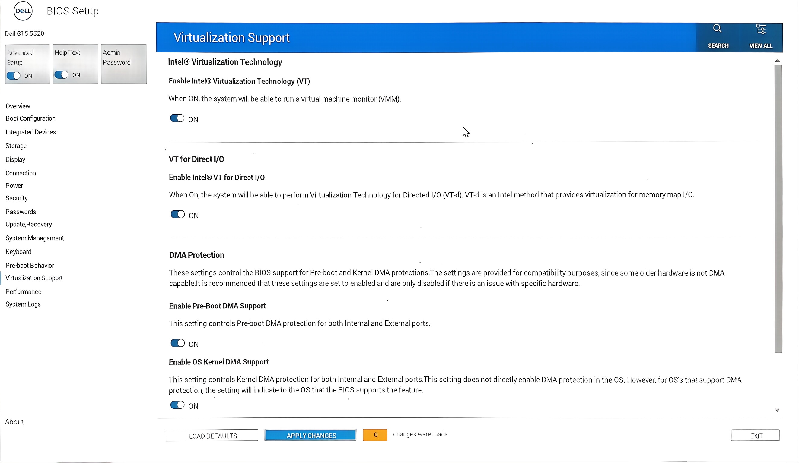

# KVM 虚拟机 安装与配置

> By WuDiXianXin
> 适用：CachyOS / Arch 系。
> 本文只覆盖基础 KVM + virt-manager 安装配置，以 CachyOS 官方教程为基线。
> 
> Windows 10 专项 **[013_KVM_安装_Win10](./013_KVM_安装_Win10.md)**。
> 主机-虚拟机文件系统互通 **[014_KVM_使用_Virtio-FS_共享主机-虚拟机文件系统](./014_KVM_使用_Virtio-FS_共享主机-虚拟机文件系统.md)**
> [015_KVM_显卡直通热切换_固定内存与_Looking-Glass_配置指南](./015_KVM_显卡直通热切换_固定内存与_Looking-Glass_配置指南.md)
> 图例：✅ 基础必需 / 🟡 建议 / 🧪 可选

## 目录

- [快速安装与配置](#快速安装与配置)
- [BIOS设置](#BIOS设置)
- [检查硬件虚拟化](#检查硬件虚拟化)
- [准备KVM存储目录](#准备KVM存储目录)
- [安装必要软件包](#安装必要软件包)
- [配置libvirt防火墙后端](#配置libvirt防火墙后端)
- [用户组与服务](#用户组与服务)
- [启动并自启默认网络](#启动并自启默认网络)
- [防火墙放行(仅使用ufw时)](#防火墙放行(仅使用ufw时))
- [安装后验证](#安装后验证)
- [启动图形化管理工具](#启动图形化管理工具)
- [基础故障排查](#基础故障排查)

## 快速安装与配置

```bash
# 1. 安装基础软件包
sudo pacman -S --needed qemu-full libvirt virt-manager dnsmasq edk2-ovmf swtpm
# 可选
# sudo pacman -S --needed virt-viewer openbsd-netcat dmidecode

# 2. 配置 libvirt 防火墙后端（要注意避免重复追加）
if ! grep -q '^[[:space:]]*firewall_backend' /etc/libvirt/network.conf 2>/dev/null; then
  echo 'firewall_backend = "iptables"' | sudo tee -a /etc/libvirt/network.conf
fi

# 3. 用户组
sudo usermod -aG libvirt,kvm "$USER"

# 4. 启用服务
# sudo systemctl enable --now libvirtd
sudo systemctl enable --now libvirtd.socket
sudo systemctl enable --now libvirtd.service
sudo systemctl enable --now virtlogd.service

# 5. 启动并自启默认网络
sudo virsh net-start default 2>/dev/null || true
sudo virsh net-autostart default

# 6. 如果使用 ufw，放行虚拟机 NAT 流量
sudo ufw route allow from 192.168.122.0/24

# 7. 验证
virt-host-validate
lsmod | grep kvm
systemctl status libvirtd.socket
virsh net-list --all
```

> [!TIP]
> 完成后请**重新登录或重启**，确保用户组权限生效。
> 然后打开 `virt-manager` 创建虚拟机。

## BIOS设置

### ✅ 基础 KVM 必需

- 开启 Intel VT-x / AMD-V（虚拟化支持）。



> [!TIP]
> 基础 KVM 不需要关闭主机 Secure Boot。
> Windows 11 需要的 UEFI + TPM 2.0 是在 `virt-manager` 里配置，不是靠关闭主机 Secure Boot。
> 关闭 Secure Boot、开启 VT-d/IOMMU、开启混显属于显卡直通进阶内容，见第二篇文档。

## 检查硬件虚拟化

```bash
LC_ALL=C.UTF-8 lscpu | grep Virtualization
grep -E --color=auto 'vmx|svm' /proc/cpuinfo        # 检测 CPU 虚拟化标志
lsmod | grep kvm                                    # 验证内核模块是否加载
# rg 'vmx|svm' /proc/cpuinfo
# lsmod | rg kvm
```

若 `lsmod` 无输出，手动加载模块：

```bash
# 二选一
sudo modprobe kvm_intel  # Intel CPU
sudo modprobe kvm_amd    # AMD CPU
```

## 准备KVM存储目录

> [!TIP]
> 这一步可选，但建议做。把虚拟机磁盘、ISO、共享目录集中到 `/kvm`，便于管理。

### 非 Btrfs 分区

```bash
sudo mkdir -p /kvm/iso /kvm/share_dir
sudo chown -R "$USER":"$USER" /kvm
```

### Btrfs 分区

#### 创建 `@kvm` 子卷

可在 live ISO 环境或主系统中操作。以 `/dev/nvme0n1p3` 为例，请替换为你的 Btrfs 分区：

```bash
sudo mount -o subvolid=5 /dev/nvme0n1p3 /mnt
sudo btrfs subvolume create /mnt/@kvm
sudo umount /mnt
```

#### 创建挂载点并写入 fstab

```bash
sudo mkdir -p /kvm
```

编辑 `/etc/fstab`，加入类似一行（UUID 请用 `blkid` 查询替换）：

```txt
UUID=266a2b91-1b69-46e4-a562-5177e3fb243a /kvm btrfs rw,noatime,nodatacow,noexec,nodev,nosuid,commit=60,subvol=/@kvm 0 0
```

> [!TIP]
> `nodatacow` 关闭 CoW，适合虚拟机磁盘镜像。
> `noexec,nodev,nosuid` 提升安全性；但如果你计划在 `/kvm/share_dir` 放可执行文件给虚拟机共享，`noexec` 会限制执行，可按需去掉。
> `commit=60` 降低提交频率，断电时可能丢失最多 60 秒数据，按需调整。

检查 fstab：

```bash
grep kvm /etc/fstab
```

#### 挂载并创建子目录

```bash
sudo systemctl daemon-reload
sudo mount -a

sudo mkdir -p /kvm/iso /kvm/share_dir
```

#### 关闭 CoW 并设置属主

> [!TIP]
> `chattr +C` 只对设置后**新建**的文件生效；已有文件需要重写或 `cp --reflink=never`。
> 如果 fstab 已使用 `nodatacow`，这一步是双保险，可保留。

```bash
sudo chattr +C /kvm
sudo chattr +C /kvm/iso
sudo chattr +C /kvm/share_dir

sudo chown -R "$USER":"$USER" /kvm
```

#### 验证

```bash
findmnt /kvm
lsattr -d /kvm /kvm/iso /kvm/share_dir
```

`lsattr` 输出中应看到 `C` 标志。

## 安装必要软件包

```bash
sudo pacman -S --needed qemu-full libvirt virt-manager dnsmasq edk2-ovmf swtpm
```

可选包：

```bash
sudo pacman -S --needed virt-viewer openbsd-netcat dmidecode
```


| 软件包 | 定位 | 作用 |
|---|---|---|
| `qemu-full` | ✅ 核心必需 | KVM 依赖的虚拟化核心引擎，兼容性最好 |
| `libvirt` | ✅ 核心必需 | 管理虚拟化平台的 API 和工具，是 `virt-manager` 的基础 |
| `virt-manager` | ✅ 核心必需 | 图形化虚拟机管理工具 |
| `dnsmasq` | ✅ 核心必需 | 为虚拟机提供 DNS 和 DHCP 服务，默认虚拟网络依赖 |
| `edk2-ovmf` | ✅ 核心必需 | 提供 UEFI 固件支持 |
| `swtpm` | 🟡 Windows 11 | TPM 模拟工具，Windows 11 需要 TPM 2.0 |
| `virt-viewer` | 🧪 可选 | 连接和显示虚拟机图形界面 |
| `openbsd-netcat` | 🧪 可选 | 网络工具，端口转发测试、虚拟机网络调试 |
| `dmidecode` | 🧪 可选 | 读取与解码 SMBIOS/DMI 硬件信息。可用于在虚拟机内识别虚拟化平台，或在宿主机上提取真实硬件信息以自定义虚拟机的 SMBIOS 标识（进阶伪装/调试）。 |


## 配置libvirt防火墙后端

CachyOS 上 libvirt 默认网络容易和防火墙冲突，建议配置：

```bash
if ! grep -q '^[[:space:]]*firewall_backend' /etc/libvirt/network.conf; then
  echo 'firewall_backend = "iptables"' | sudo tee -a /etc/libvirt/network.conf
fi
```

如果文件里已有 `firewall_backend`，不要重复追加，先检查：

```bash
grep -n 'firewall_backend' /etc/libvirt/network.conf
```

## 用户组与服务

### 将用户加入必要用户组

```bash
sudo usermod -aG libvirt,kvm "$USER"
```

完成后需**重新登录、重启**或执行 `newgrp libvirt` 使配置生效。

> [!TIP]
> `kvm` 组用于直接访问 `/dev/kvm`，通常无副作用；如注重最小权限，可只加 `libvirt`。

### 启用 libvirt 服务

```bash
# sudo systemctl enable --now libvirtd
sudo systemctl enable --now libvirtd.socket
sudo systemctl enable --now libvirtd.service
sudo systemctl enable --now virtlogd.service
```

> [!TIP]
> 不要开机自启 `dnsmasq` 服务。libvirt 在创建和开启虚拟机时会自动实例化 dnsmasq 进程。

## 启动并自启默认网络

```bash
sudo virsh net-start default 2>/dev/null || true
sudo virsh net-autostart default
```

验证：

```bash
virsh net-list --all
```

## 防火墙放行(仅使用ufw时)

```bash
sudo ufw route allow from 192.168.122.0/24
```

> [!TIP]
> 如果使用 firewalld/nftables，需要对应调整规则。

## 安装后验证

```bash
virt-host-validate
lsmod | grep kvm
systemctl status libvirtd.socket
virsh net-list --all
```

## 启动图形化管理工具

```bash
virt-manager
```

## 基础故障排查

### `lsmod | grep kvm` 无输出

```bash
sudo modprobe kvm_intel   # Intel
sudo modprobe kvm_amd     # AMD
```

### 默认网络未启动

```bash
sudo virsh net-start default
sudo virsh net-autostart default
virsh net-list --all
```

### 防火墙导致虚拟机无网络

```bash
grep -n 'firewall_backend' /etc/libvirt/network.conf
```

如果使用 ufw：

```bash
sudo ufw route allow from 192.168.122.0/24
```

### 权限不足

```bash
groups
```

应包含 `libvirt`，可选包含 `kvm`。修改后需重新登录或重启。
