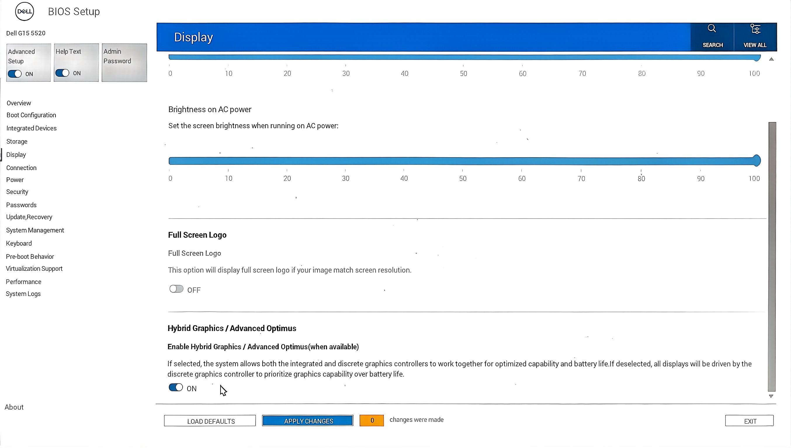

# KVM 显卡直通热切换、固定内存与 Looking Glass 配置指南

> [!NOTE]
> By WuDiXianXin

## 目录

- [热切换显卡直通和固定内存](#热切换显卡直通和固定内存)
- [开启虚拟机前](#开启虚拟机前)
- [关闭虚拟机后](#关闭虚拟机后)
- [Looking Glass](#Looking-Glass)

## 热切换显卡直通和固定内存

### 开启虚拟机前

#### 开启显卡直通

##### 开启混显

在 BIOS 中开启混显。



##### 查找 NVIDIA 的 DRM 设备

```bash
sudo ls -l /sys/class/drm/card*/device/driver
sudo ls -l /sys/class/drm/render*/device/driver

sudo ls -l /dev/dri/by-path/
```

示例输出：

```txt
lrwxrwxrwx 1 root root 0 10月18日 15:58 /sys/class/drm/card1/device/driver -> ../../../../bus/pci/drivers/nvidia
lrwxrwxrwx 1 root root 0 10月18日 15:58 /sys/class/drm/card2/device/driver -> ../../../bus/pci/drivers/i915
lrwxrwxrwx 1 root root 0 10月18日 15:58 /sys/class/drm/renderD128/device/driver -> ../../../../bus/pci/drivers/nvidia
lrwxrwxrwx 1 root root 0 10月18日 15:58 /sys/class/drm/renderD129/device/driver -> ../../../bus/pci/drivers/i915
```

```txt
总计 0
lrwxrwxrwx 1 root root  8 10月18日 15:57 pci-0000:00:02.0-card -> ../card2
lrwxrwxrwx 1 root root 13 10月18日 15:57 pci-0000:00:02.0-render -> ../renderD129
lrwxrwxrwx 1 root root  8 10月18日 15:57 pci-0000:01:00.0-card -> ../card1
lrwxrwxrwx 1 root root 13 10月18日 15:57 pci-0000:01:00.0-render -> ../renderD128
```

#### 关闭 NVIDIA 显卡上的所有进程

##### 查找 NVIDIA 显卡上的进程

```bash
sudo fuser -v /dev/nvidia*
sudo fuser -v /dev/dri/by-path/pci-0000:01:00.0-card
sudo fuser -v /dev/dri/by-path/pci-0000:01:00.0-render
```

##### 关闭这些进程

###### 关闭 niri

在 niri 的 `config.kdl` 中添加以下内容，然后重启 `niri-session`：

```kdl
debug {
    // 不使用 N 卡
    ignore-drm-device "/dev/dri/by-path/pci-0000:01:00.0-card"
    ignore-drm-device "/dev/dri/by-path/pci-0000:01:00.0-render"
}
```

###### 关闭所有使用 NVIDIA 的程序

```bash
sudo fuser -k -9 /dev/nvidia*
```

#### 移除 NVIDIA 的所有内核模块

```bash
sudo lsmod | rg nvidia
```

示例输出：

```txt
nvidia_wmi_ec_backlight    12288  0
nvidia_drm            184320  0
nvidia_uvm           2383872  0
nvidia_modeset       1916928  1 nvidia_drm
nvidia              17702912  2 nvidia_uvm,nvidia_modeset
drm_ttm_helper         20480  2 nvidia_drm,xe
video                  81920  6 nvidia_wmi_ec_backlight,dell_wmi,dell_laptop,xe,i915,nvidia_modeset
drm_display_helper    307200  3 nvidia_drm,xe,i915
wmi                    45056  10 dell_wmi_sysman,video,nvidia_wmi_ec_backlight,dell_wmi_ddv,alienware_wmi,dell_wmi,wmi_bmof,dell_smm_hwmon,dell_smbios,dell_wmi_descriptor
aead                   16384  4 ccm,nvidia,mac80211,aesni_intel
```

依次移除模块：

```bash
sudo rmmod nvidia_wmi_ec_backlight
sudo rmmod nvidia_drm
sudo rmmod nvidia_uvm
sudo rmmod nvidia_modeset
sudo rmmod nvidia
```

#### 解绑驱动

##### 查询驱动

```bash
lspci -Dk | grep -A 2 -i nvidia

# 或以下命令
lspci -Dk | rg -i -A 2 nvidia
lspci -Dk | rg -iA 2 nvidia
```

示例输出：

```text
0000:01:00.0 VGA compatible controller: NVIDIA Corporation GA106M [GeForce RTX 3060 Mobile / Max-Q] (rev a1)
    Subsystem: Dell Device 0b56
    Kernel modules: nouveau, nvidia_drm, nvidia
0000:01:00.1 Audio device: NVIDIA Corporation GA106 High Definition Audio Controller (rev a1)
    Subsystem: NVIDIA Corporation Device 0000
    Kernel driver in use: snd_hda_intel
    Kernel modules: snd_hda_intel
```

##### 从驱动解绑

```bash
# 这里也许会报错，因为前面已经 rmmod nvidia 之后可能已经解绑了
echo "0000:01:00.0" | sudo tee /sys/bus/pci/drivers/nvidia/unbind

# 解绑音频模块驱动
echo "0000:01:00.1" | sudo tee /sys/bus/pci/drivers/snd_hda_intel/unbind
```

##### 让 vfio-pci 接管

```bash
# 加载 vfio 模块
sudo modprobe vfio-pci

# 覆盖驱动为 vfio-pci
echo "vfio-pci" | sudo tee /sys/bus/pci/devices/0000:01:00.0/driver_override
echo "vfio-pci" | sudo tee /sys/bus/pci/devices/0000:01:00.1/driver_override

# 重新扫描设备并绑定 vfio-pci
echo "0000:01:00.0" | sudo tee /sys/bus/pci/drivers_probe
echo "0000:01:00.1" | sudo tee /sys/bus/pci/drivers_probe
```

检测绑定结果：

```bash
lspci -Dk | grep -A 2 -i nvidia | grep use

# 或以下命令
lspci -Dk | rg -i -A 2 nvidia | rg use
lspci -Dk | rg -iA 2 nvidia | rg use
```

### 热切换内存大页

默认的内存大页是 2 MB。

#### 释放缓存和清理内存碎片

```bash
sudo sync
echo 3 | sudo tee /proc/sys/vm/drop_caches
echo 1 | sudo tee /proc/sys/vm/compact_memory
```

#### 分配内存大页

```bash
# 分配 4096 个 2MB 大页，共 8GB
sudo sysctl -w vm.nr_hugepages=4096
```

#### 确认是否成功

```bash
cat /proc/sys/vm/nr_hugepages
```

#### 修改虚拟机 XML

将以下内容放在 `<currentMemory>` 标签下面一行。标签 `<hugepages/>` 是关键。

```xml
<memoryBacking>
  <hugepages/>
  <source type="memfd"/>
  <access mode="shared"/>
</memoryBacking>
```

### 关闭虚拟机后

#### 关闭显卡直通

##### 确认显卡直通虚拟机已经关闭

一定要关闭虚拟机，否则可能会导致系统卡死。

##### 解绑 vfio

```bash
# 移除驱动覆盖
echo "" | sudo tee /sys/bus/pci/devices/0000:01:00.0/driver_override
echo "" | sudo tee /sys/bus/pci/devices/0000:01:00.1/driver_override

# 解绑 vfio
echo "0000:01:00.0" | sudo tee /sys/bus/pci/drivers/vfio-pci/unbind
echo "0000:01:00.1" | sudo tee /sys/bus/pci/drivers/vfio-pci/unbind
```

##### 重新加载 NVIDIA 模块

```bash
sudo modprobe nvidia
sudo modprobe nvidia_drm
sudo modprobe nvidia_modeset
sudo modprobe nvidia_uvm
```

##### 重新检测并激活显卡

```bash
echo "0000:01:00.0" | sudo tee /sys/bus/pci/drivers_probe
echo "0000:01:00.1" | sudo tee /sys/bus/pci/drivers_probe
```

#### 释放内存大页

```bash
sudo sysctl -w vm.nr_hugepages=0
cat /proc/sys/vm/nr_hugepages
```

## Looking-Glass

> [!IMPORTANT]
> Looking Glass 不用显卡直通也能使用，但性能不如显卡直通高。

> [!TIP]
> 必须安装好 Windows 10/11 虚拟机后，才能进行 Looking Glass 安装配置。
>
> 安装 Looking Glass 前，需要一个虚拟显卡（qxl 或 virtio 都行，建议 virtio），以便进入 virt-manager 虚拟机系统界面。
>
> 安装 Looking Glass 后，virt-manager 虚拟机系统界面可能黑屏；此时不要担心，在 Linux 主机上打开终端并执行 `looking-glass-client` 后，会打开一个窗口用于显示 Windows 10/11 虚拟机界面。

### 安装配置 Looking Glass

前往 [官网下载](https://looking-glass.io/downloads)

下载 Latest builds Release channels 中 Stable 标签框或 Development 标签框中的 Source 和 Windows IDD。

> [!TIP]
> 注意必须是同一个标签框中的版本，否则可能无法协同工作。

- Source：Linux 主机（主系统）的编译项目源代码。
- Windows IDD：Windows 10/11 虚拟机内部的可安装驱动压缩包。

#### 下载源码与 Windows IDD

将源码解压到一个目录中，例如 `~/build`。

这里下载的是 `looking-glass-B7-829-cdba29f2`，属于 B7 开发版（dev）源码。

接下来的流程是：先编译并安装 Linux 客户端，然后处理 KVMFR 内核模块。

由于开发版与稳定版的配置可能略有差异，请确保 Windows 客户机端的 IDD 驱动与当前源码版本严格匹配。

#### 编译 Source

##### 安装编译依赖

针对 CachyOS（Arch 系），官方 Wiki 提供了完整的依赖列表。建议一次性安装客户端和内核模块所需的所有软件包。

[依赖列表参考（包括多个 Linux 发行版）](https://looking-glass.io/docs/B7/build/#installing-build-dependencies)

```bash
sudo pacman -Syu
sudo pacman -S --needed cmake gcc libgl libegl fontconfig spice-protocol make nettle pkgconf binutils \
libxi libxinerama libxss libxcursor libxpresent libxkbcommon wayland-protocols ttf-dejavu \
libsamplerate dkms # linux-headers
```

> [!TIP]
> 请确保 `linux-headers` 与当前运行的内核版本严格匹配。
>
> CachyOS 不需要额外安装 `linux-headers` 等其他内核头文件，默认有 `linux-cachyos-headers`。

##### 编译并安装 Linux 客户端

Looking Glass 的构建系统基于 CMake，标准流程是在 `client/` 目录下创建一个独立的 `build` 文件夹进行外部构建。

```bash
# 1. 进入源码目录中的 client 子目录
cd ~/build/looking-glass-B7-829-cdba29f2/client

# 2. 创建并进入构建目录
mkdir -p build
cd build

# 3. 运行 cmake 生成构建文件
cmake ..

# 4. 编译客户端。可以使用 -j 参数指定并行编译的线程数
make -j$(nproc)

# 5. 安装客户端
sudo make install
```

执行完 `make install` 后，客户端二进制文件 `looking-glass-client` 会被安装到系统路径中。

##### 安装与配置 KVMFR 内核模块

KVMFR 模块的源码位于下载的源码包中的 `module/` 目录。

**1. 通过 DKMS 安装模块**

使用 DKMS 可以确保在内核升级后模块自动重新编译。

```bash
cd ~/build/looking-glass-B7-829-cdba29f2/module/
sudo dkms install "."
```

**2. 配置模块加载参数**

需要根据计划使用的最大分辨率，通过 `static_size_mb` 参数为 KVMFR 分配共享内存。常见配置如下：

- 1080p / 1440p（SDR）：`static_size_mb=32`
- 4K（SDR）：`static_size_mb=128`

创建或编辑 `/etc/modprobe.d/kvmfr.conf`，写入你的选择。以 1080p 为例：

```txt
options kvmfr static_size_mb=32
```

**3. 设置开机自动加载**

创建 `/etc/modules-load.d/kvmfr.conf`，使系统启动时自动加载模块：

```txt
kvmfr
```

**4. 配置设备权限（CachyOS 关键点）**

在现代 CachyOS/Arch 系统上，旧的 `OWNER` udev 规则会失效。正确做法是只依靠 `GROUP` 来授权，并确保你的用户属于该组。

创建 udev 规则 `/etc/udev/rules.d/70-kvmfr.rules`：

```txt
SUBSYSTEM=="kvmfr", GROUP="kvm", MODE="0660", TAG+="uaccess"
```

将你的用户加入 `kvm` 组：

```bash
sudo usermod -aG kvm $USER
```

> [!NOTE]
> 此更改需要重新登录或重启才能生效。

**5. 加载模块并验证**

完成配置后，可以重启系统，或者手动加载模块：

```bash
sudo modprobe kvmfr
```

验证设备节点是否正确创建：

```bash
sudo ls -l /dev/kvmfr0
```

成功的输出应该类似：

```txt
crw-rw----+ 1 root kvm 510, 0 10月19日 11:47 /dev/kvmfr0
```

权限以 `c` 开头（字符设备），且组为 `kvm`。

#### 配置虚拟机与客户机

这部分与通用流程一致。

1. **配置虚拟机 XML**

使用 `virsh edit <虚拟机名>` 编辑虚拟机 XML，将 `/dev/kvmfr0` 作为 IVSHMEM 的后端挂载给虚拟机。

`size` 参数必须与 `static_size_mb` 的值完全一致。例如：

- 32 MiB = `33554432` 字节
- 128 MiB = `134217728` 字节

```xml
<qemu:commandline>
  <qemu:arg value='-device'/>
  <qemu:arg value='{"driver":"ivshmem-plain","memdev":"looking-glass","id":"shmem0"}'/>
  <qemu:arg value='-object'/>
  <qemu:arg value='{"qom-type":"memory-backend-file","id":"looking-glass","mem-path":"/dev/kvmfr0","share":true,"size":33554432}'/>
</qemu:commandline>
```

或者使用下面这种写法（virt-manager 可能会把上面的转换成下面的形式）：

```xml
<qemu:commandline>
  <qemu:arg value="-device"/>
  <qemu:arg value="{&quot;driver&quot;:&quot;ivshmem-plain&quot;,&quot;memdev&quot;:&quot;looking-glass&quot;,&quot;id&quot;:&quot;shmem0&quot;}"/>
  <qemu:arg value="-object"/>
  <qemu:arg value="{&quot;qom-type&quot;:&quot;memory-backend-file&quot;,&quot;id&quot;:&quot;looking-glass&quot;,&quot;mem-path&quot;:&quot;/dev/kvmfr0&quot;,&quot;share&quot;:true,&quot;size&quot;:33554432}"/>
</qemu:commandline>
```

2. **Windows 客户机**

在 Windows 内安装与 B7-dev 源码包版本匹配的 Looking Glass IDD。安装过程中确保勾选 IVSHMEM 驱动。

### 配置检查与排错

#### 检查配置文件

检查以下三个文件是否存在：

```bash
sudo ls -al /etc/modules-load.d/kvmfr.conf
sudo ls -al /etc/modprobe.d/kvmfr.conf
sudo ls -al /etc/udev/rules.d/70-kvmfr.rules
```

检查文件内容：

```bash
cat /etc/udev/rules.d/70-kvmfr.rules
cat /etc/modprobe.d/kvmfr.conf
cat /etc/modules-load.d/kvmfr.conf
```

预期内容如下：

```bash
# /etc/udev/rules.d/70-kvmfr.rules
SUBSYSTEM=="kvmfr", GROUP="kvm", MODE="0660", TAG+="uaccess"

# /etc/modprobe.d/kvmfr.conf
options kvmfr static_size_mb=32

# /etc/modules-load.d/kvmfr.conf
kvmfr
```

#### 各配置文件作用

`/etc/modules-load.d/kvmfr.conf`

作用是在系统启动时自动加载 `kvmfr` 内核模块。

`/etc/modprobe.d/kvmfr.conf`

为模块设置默认参数，会在模块加载时生效，静态分配 32 MB 共享内存。如果 Looking Glass 使用场景需要更大显存，例如 4K 分辨率，可以将 `32` 调大，如 `64` 或 `128`。

`/etc/udev/rules.d/70-kvmfr.rules`

该规则高度依赖于 systemd 版本。Arch Linux 和 CachyOS 用户可以放心使用。

`TAG+="uaccess"` 写法是针对 systemd 258 及以上版本的推荐方案。从该版本开始，`systemd-udevd` 会忽略 udev 规则中为非系统用户/组设置的 `OWNER`/`GROUP`，转而使用 `uaccess` 标签来动态地将设备权限分配给当前登录的桌面用户。

将规则文件命名为 `70-kvmfr.rules` 也是正确的。因为 `uaccess` 标签由 `73-seat-late.rules` 处理，规则文件名序号 70 必须小于 73，才能确保在 `uaccess` 处理之前生效。

> [!NOTE]
> 如果 systemd 版本低于 258，`uaccess` 标签可能无法按预期工作。在这种情况下，传统的 `OWNER`/`GROUP` 写法会更可靠。

#### 验证与排错

1. **重新加载并触发规则**

```bash
sudo udevadm control --reload-rules
sudo udevadm trigger
```

这会让新的 udev 规则立即生效，无需重启。

2. **检查模块是否加载**

```bash
lsmod | grep kvmfr

# 或以下命令
dmesg | rg kvmfr
```

如果看到 `kvmfr` 模块，说明已加载。

3. **检查设备节点**

```bash
ls -l /dev/kvmfr0
```

应该能看到一个字符设备，行首为 `c`。其权限和所有者应反映 udev 规则的结果。

如果看到的是一个普通文件，或大小不为 0，说明模块可能在 QEMU 启动之后才加载。此时需要删除该文件并重新加载模块。

4. **查看内核日志**

```bash
dmesg | grep kvmfr

# 或以下命令
dmesg | rg kvmfr
```

如果配置成功，日志中应出现类似以下信息：

```txt
kvmfr: creating 1 static devices
```
